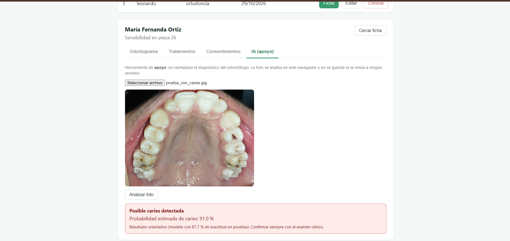
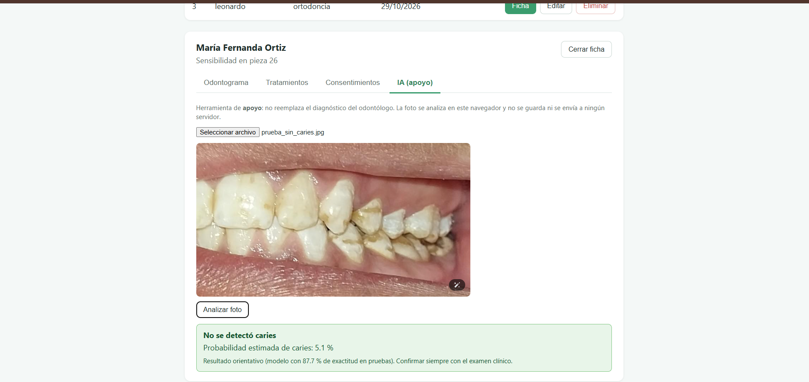

# OdontoHistoria IA — Panel web de la clínica (React + Vite)

Panel web de la clínica dental **Fassiara**. Permite gestionar pacientes y su ficha clínica (odontograma, tratamientos, consentimientos) y, como apoyo, **analizar una foto intraoral con un modelo de Machine Learning que corre en el navegador**.

- **Estudiante:** Wilfredo Alcedo Santiago (ID 001634197) — SENATI, Ingeniería de Software con IA, bloque 32 PIADS401 2026
- **Instructor:** Darwin Uzuriaga Claudio · **Empresa:** Lihon Corporation E.I.R.L

## Los 3 repositorios del proyecto

| Parte | Repositorio |
|---|---|
| Panel web — **este repositorio** | https://github.com/wilfredoalced-byte/odontohistoria-frontend |
| Backend (API REST + módulo de Machine Learning) | https://github.com/wilfredoalced-byte/odontohistoria-backend |
| App Android del paciente | https://github.com/wilfredoalced-byte/odontohistoria-app |

## Cómo abrirlo y ejecutarlo (paso a paso)

**Requisitos:** [Node.js](https://nodejs.org) **20.19 o superior** (se probó con la 22; el panel usa Vite 8, que no funciona con Node 18) y Git. El panel necesita el **backend encendido** para mostrar datos.

1. **Encender el backend** (en otra terminal):
   ```bash
   git clone https://github.com/wilfredoalced-byte/odontohistoria-backend.git
   cd odontohistoria-backend
   npm install
   node server.js        # queda en http://localhost:3000
   ```
2. **Descargar e instalar el panel:**
   ```bash
   git clone https://github.com/wilfredoalced-byte/odontohistoria-frontend.git
   cd odontohistoria-frontend
   npm install
   ```
3. **Encender el panel:**
   ```bash
   npm run dev
   ```
   Abrir en el navegador la dirección que muestra la terminal: **http://localhost:5173**
4. Para generar la versión de producción: `npm run build`.

## Qué se puede hacer en el panel

| Función | Cómo se usa |
|---|---|
| Lista de pacientes | Aparece al abrir; hay buscador por nombre y contador. |
| Crear, editar y eliminar pacientes | Formulario "Nuevo paciente" y botones **Editar** / **Eliminar**. |
| Ficha del paciente | Botón **Ficha** → 4 pestañas: **Odontograma**, **Tratamientos**, **Consentimientos** e **IA (apoyo)**. |
| Odontograma | Clic en una pieza para cambiar su estado (Sano → Caries → Tratado). Se guarda en el backend. |
| Tratamientos | Agregar tratamientos con fecha y cambiar su estado. |
| Consentimientos | Marcar el consentimiento informado (texto en borrador). |
| **IA (apoyo)** | Subir una foto intraoral y pulsar **Analizar foto** (ver abajo). |

## Pestaña "IA (apoyo)": análisis de caries con Machine Learning

1. Abrir la **Ficha** de un paciente → pestaña **IA (apoyo)**.
2. **Seleccionar archivo** (foto .jpg de la boca) y pulsar **Analizar foto**.
3. El panel muestra **"Posible caries detectada"** (rojo) o **"No se detectó caries"** (verde), con la probabilidad estimada y el aviso *"Resultado orientativo… Confirmar siempre con el examen clínico"*.

**Cómo funciona:** el modelo (MobileNetV2 entrenado en Google Colab, ver el módulo `ml/` del backend) está exportado a TensorFlow.js en [`public/modelo-caries/`](public/modelo-caries) (`model.json` + 3 archivos `.bin`, 8.8 MB). El componente [`src/components/AnalisisIA.jsx`](src/components/AnalisisIA.jsx) reduce la foto a 224×224, ejecuta el modelo y considera "posible caries" si la probabilidad es 0.5 o más. **La foto se analiza en el navegador: no se envía ni se guarda en ningún servidor.**

Rendimiento del modelo en 921 fotos de prueba: exactitud 87.7 %, precisión 81.0 %, sensibilidad 83.8 %, F1 82.4 %. **Es una herramienta de apoyo; no reemplaza el diagnóstico del odontólogo.**

### Evidencia de prueba (22/11/2026)

Las dos fotos de prueba están en [`docs/fotos_prueba/`](docs/fotos_prueba): se pueden descargar y subir en la pestaña IA para repetir la prueba.

| Foto de prueba | Resultado en el panel |
|---|---|
| `prueba_con_caries.jpg` | Posible caries detectada — 91.0 % |
| `prueba_sin_caries.jpg` | No se detectó caries — 5.1 % |





(En Colab las mismas fotos dieron 79.7 % y 6.0 %: la decisión es la misma y el porcentaje cambia por el método de redimensionado de la foto. Más detalle en `docs/capturas_ia/README.md`.)

## Estructura del proyecto

| Ruta | Qué contiene |
|---|---|
| `src/App.jsx`, `src/api.js` | Pantalla principal y llamadas al backend (`http://localhost:3000`). |
| `src/components/` | `PacientesTabla`, `PacienteForm`, `FichaPaciente`, `Odontograma`, `Tratamientos`, `Consentimientos` y `AnalisisIA`. |
| `public/modelo-caries/` | Modelo de caries en formato TensorFlow.js. |
| `docs/capturas_ia/` | Capturas de prueba de la pestaña IA. |

## Ramas

| Rama | Contenido |
|---|---|
| `main` | Versión estable del panel. |
| `feature/ia-caries` | Pestaña "IA (apoyo)" con el modelo de caries. |

## Tecnología

React 19 · Vite · TensorFlow.js 4.22 · JavaScript (ES modules).

## Limitaciones

- Funciona con el backend en `localhost:3000` (versión de desarrollo, sin HTTPS ni login real).
- El modelo se entrenó con un dataset público de una sola fuente; no se probó con fotos de la clínica ni con distintos celulares. Clasifica la foto completa, no ubica la caries.
- Los textos de consentimiento son un borrador y requieren revisión legal.
